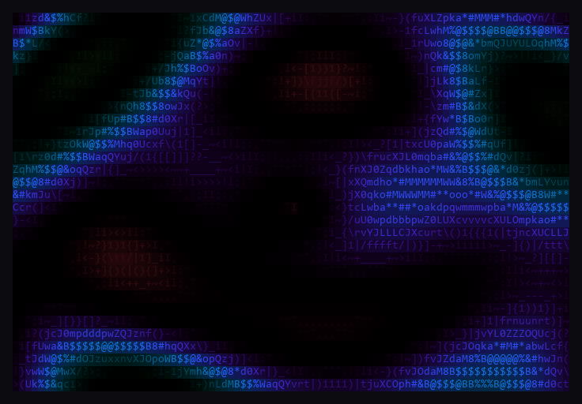

<h1 align="center">
  <br>
  <a>
  
</a>

  <br>
  <b>chromascii</b>
  <br>
</h1>

<h4 align="center">Play any video or GIF as full-color ASCII art, live in your terminal.
</h4>

<p align="center">
  <a href="#project-status">Status</a> |
  <a href="#how-to-install">How to install</a> |
  <a href="#usage">Usage</a> |
  <a href="#recipes">Recipes</a> |
  <a href="#options">Options</a> |
  <a href="#how-it-works">How it works</a> |
  <a href="#troubleshooting">Troubleshooting</a> |
  <a href="#license">License</a>
</p>

chromascii streams a video through ffmpeg, shrinks every frame to the size of your terminal and redraws it as
characters in **24-bit true color**: every character is painted in the exact color of the pixel it replaces, on a
dimmed copy of that color as its background. Bright areas get dense characters (`@ # $`), dark areas get light
ones (`. : -`), and contrast is stretched per frame, so even dull footage uses the whole range. Prefer pixels?
**Blocks mode** packs two pixels into every cell with the `▀` half-block for near-video sharpness.

> [!TIP]
> Detail scales with the number of characters on screen. **Maximize the window and zoom out (`Ctrl` + `-`)**
> before you hit play.

<br>

## Project status

**Works.** Tested on Windows 11 with Windows Terminal, Python 3.13 and ffmpeg 8.

| What | Status |
|---|---|
| MP4, MOV, WEBM, MKV, GIF and anything else ffmpeg reads | ✅ Works |
| 24-bit color characters with color-filled background | ✅ Works |
| Half-block pixel mode (`-m blocks`) | ✅ Works |
| Built-in and custom character sets | ✅ Works |
| Auto-fit to terminal width and height | ✅ Works |
| Transparent GIFs | ✅ Shown on black |
| Real-time playback, looping, custom FPS | ✅ Works, ~9 ms to draw a 150×55 frame |
| Audio | ❌ Not played; picture only |
| Saving the ASCII version as a video file | ❌ Not yet |
| Terminals without true color (old `conhost`, some SSH clients) | ⚠️ Colors are approximated or missing. Use [Windows Terminal](https://aka.ms/terminal) |

## How to install

**Prerequisites:**

- [Python 3.8+](https://www.python.org/downloads/) (tick "Add python.exe to PATH").
- [ffmpeg](https://ffmpeg.org/download.html) on PATH. On Windows: `winget install Gyan.FFmpeg`. On macOS:
  `brew install ffmpeg`. On Linux: your package manager.
- A terminal with **true color**: Windows Terminal, iTerm2, Kitty, WezTerm, Alacritty, GNOME Terminal and most
  modern terminals.

**Then:**

```sh
git clone https://github.com/JustUsingAI/chromascii
cd chromascii
pip install -r requirements.txt
python chromascii.py path/to/video.mp4
```

Press `Ctrl` + `C` to stop.

## Usage

```sh
python chromascii.py clip.mp4                  # colored ASCII, fits your terminal
python chromascii.py clip.mp4 -m blocks        # half-block pixels, sharpest
python chromascii.py clip.mp4 -c dense         # 70-character set, most detail
python chromascii.py clip.mp4 --loop -w 160    # loop it, 160 characters wide
```

## Recipes

| Look | Command |
|---|---|
| Best detail | `python chromascii.py clip.mp4 -c dense --bg 0.5 -w 180 --loop` |
| Hacker / binary | `python chromascii.py clip.mp4 -c " 01" --bg 0 --boost 1.3 --loop` |
| Painted | `python chromascii.py clip.mp4 -c blocks --bg 0.8 -w 120 --loop` |
| 8-bit retro | `python chromascii.py clip.mp4 -w 50 --fps 12 --bg 0 --loop` |
| Pure ASCII, black gaps | `python chromascii.py clip.mp4 --bg 0` |
| Bubbly | `python chromascii.py clip.mp4 -c " .oO@"` |
| Near-HD pixels | `python chromascii.py clip.mp4 -m blocks -w 200 --loop` |

## Options

| Option | Default | What it does |
|---|---|---|
| `input` | *(required)* | Video or GIF to play |
| `-m`, `--mode` | `ascii` | `ascii` = colored characters, `blocks` = half-block pixels |
| `-c`, `--charset` | `classic` | `classic` (` .:-=+*#%@`), `dense` (70 characters), `blocks` (` ░▒▓█`), or your own characters from dark to bright |
| `-w`, `--width` | fit terminal | Width in characters. Height follows the video's shape |
| `--bg` | `0.35` | Background fill strength in ascii mode. `0` = black, `1` = full color |
| `--boost` | `1.0` | Pushes character choice brighter. Try `1.3`–`1.5` for dark clips |
| `--fps` | video's, max 30 | Playback frame rate |
| `--loop` | off | Repeat until `Ctrl` + `C` |

`-m blocks` ignores `--charset`, `--bg` and `--boost`: every cell is two pixels.

## How it works

```
video ─► ffprobe (size, fps) ─► ffmpeg (fps + resize, raw RGBA) ─► numpy ─► ANSI true-color text ─► terminal
```

| Step | What happens |
|---|---|
| Probe | `ffprobe` reads the video's size and frame rate |
| Fit | The target size is worked out from your terminal, with a 2:1 correction because character cells are about twice as tall as they are wide |
| Decode | `ffmpeg` resamples to the playback FPS, resizes with area averaging and streams raw RGBA frames into Python, so long videos never sit in memory |
| Map | Luminance (`0.299 R + 0.587 G + 0.114 B`) is contrast-stretched between the frame's 2nd and 98th percentile and picks a character; transparent pixels go black |
| Draw | Each cell gets `ESC[38;2;R;G;Bm` for the character and `ESC[48;2;…m` for the dimmed background. Blocks mode puts the top pixel in the foreground and the bottom pixel in the background of `▀` |
| Pace | The cursor jumps home (`ESC[H`) and the whole frame is written at once; playback sleeps to hold the frame rate and skips the wait when it's behind |

## Troubleshooting

<details>
<summary><b>It looks blurry or blocky</b></summary>

You're out of characters, not resolution. Maximize the window, zoom out with `Ctrl` + `-`, then use `-w 200` or
`-m blocks`.
</details>

<details>
<summary><b>No colors, or strange <code>[38;2;</code> text everywhere</b></summary>

Your terminal doesn't support ANSI true color. Use Windows Terminal on Windows, or any modern terminal elsewhere.
</details>

<details>
<summary><b>"ffmpeg is required"</b></summary>

Install ffmpeg and make sure `ffmpeg` and `ffprobe` both run from a new terminal window.
</details>

<details>
<summary><b>It stutters</b></summary>

Very wide output in a slow terminal can't keep up. Lower `-w`, or drop the frame rate with `--fps 15`.
</details>

## Running the tests

```sh
python test_chromascii.py
```

## License

MIT. See [LICENSE](LICENSE).
